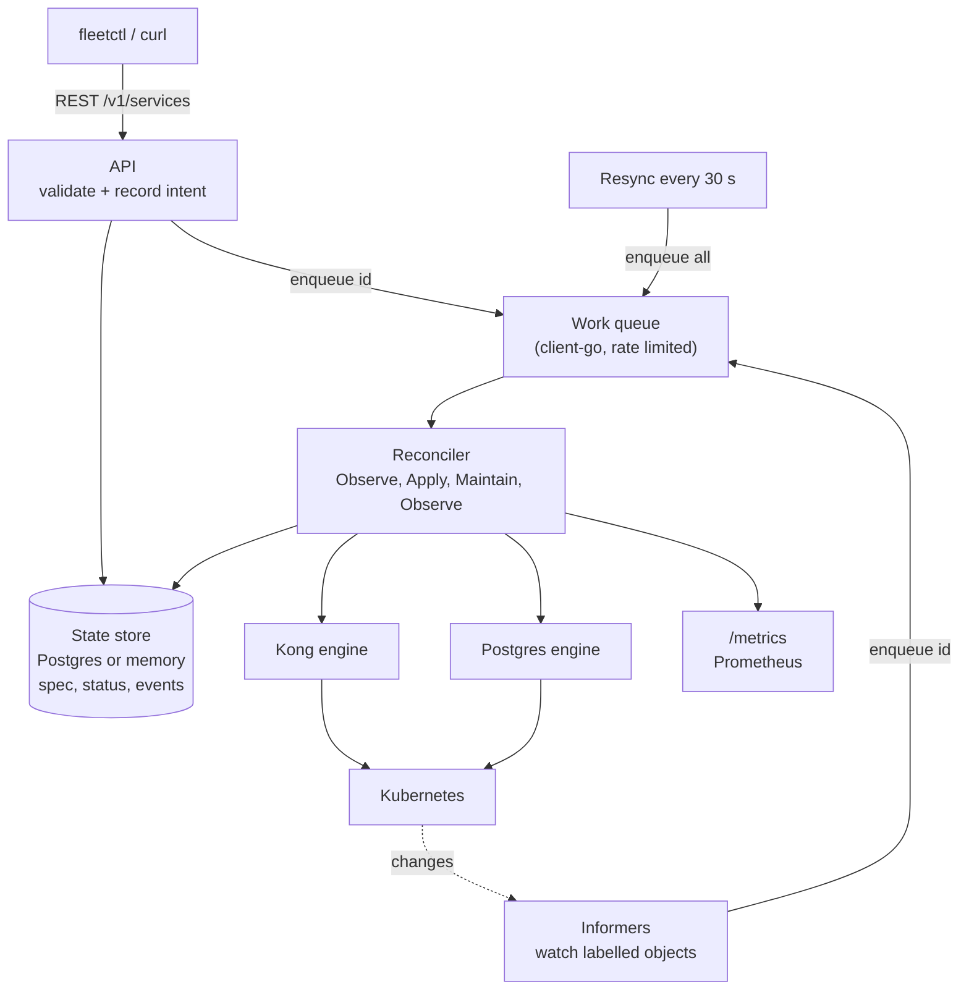
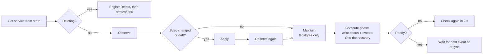
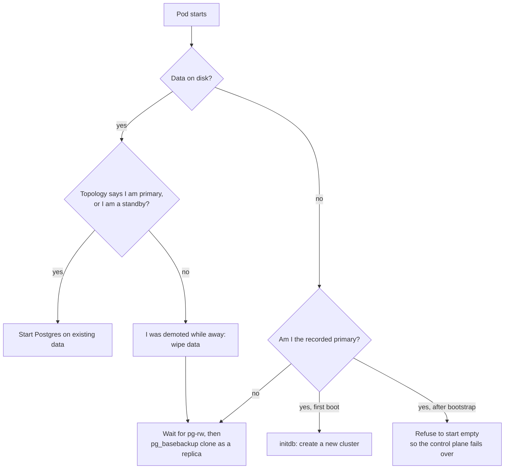
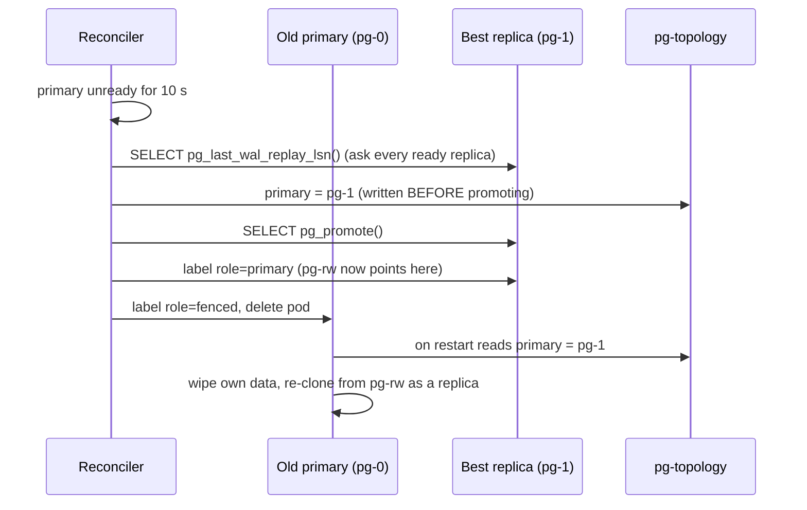

# The fleet-control-plane journey

**What we set out to do, how we designed it, how it was built, everything that went
wrong along the way and how it was fixed, how it was tested, and what comes next.**

This document is written for someone new to Kubernetes, Postgres replication or control
planes. Every technical term is explained the first time it appears, and there is a
[glossary](#13-glossary) at the end. If you only have five minutes, read
[the short version](#1-the-short-version).

---

## Contents

1. [The short version](#1-the-short-version)
2. [The agenda: why this project exists](#2-the-agenda-why-this-project-exists)
3. [Choosing what to build](#3-choosing-what-to-build)
4. [Background you need (in plain words)](#4-background-you-need-in-plain-words)
5. [The initial design](#5-the-initial-design)
6. [The build, milestone by milestone](#6-the-build-milestone-by-milestone)
7. [Problems we hit and how we fixed them](#7-problems-we-hit-and-how-we-fixed-them)
8. [How it was tested](#8-how-it-was-tested)
9. [Where it stands now](#9-where-it-stands-now)
10. [Known limitations and scope for improvement](#10-known-limitations-and-scope-for-improvement)
11. [Run it yourself, step by step](#11-run-it-yourself-step-by-step)
12. [Talking about this project in an interview](#12-talking-about-this-project-in-an-interview)
13. [Glossary](#13-glossary)

---

## 1. The short version

- **Goal:** build, in about a day, a public project that shows the skills two job
  openings ask for and that the author's resume didn't yet show: Go services, a
  Kubernetes control plane, and real Postgres operations.
- **What was built:** `fleet-control-plane`, a small program (`fleetd`) that creates
  and looks after **Kong API gateways** and **Postgres database clusters** on
  Kubernetes. You tell it what you want through a REST API or the `fleetctl` command,
  and it keeps reality matching that request: it notices when something breaks or is
  changed by hand and puts it back.
- **Headline results** (laptop cluster, 50 requests per second of live traffic):
  - 7 of 8 deliberate gateway failures caused **zero failed requests**; the gateway
    was healthy again in 0.1 to 3.8 seconds.
  - A live Kong upgrade (3.8 to 3.9) dropped **zero requests**.
  - A **hung** Postgres primary was replaced automatically: a replica was promoted at
    14.0 s and accepted writes at 14.2 s, with every committed row intact.
  - A planned Postgres switchover lost **0 bytes** of data.
- **Testing:** 66 unit test cases (plus 8 more against a real Postgres), a 14-check
  end-to-end script on a real cluster, and a chaos script that breaks things under load.
- **Size:** about 4,900 lines of Go (including tests), 8 milestones, built on an 8 GB
  MacBook Air.

---

## 2. The agenda: why this project exists

### The target roles

| Role | What the job is really about |
| --- | --- |
| **Kong, Software Engineer 2, Managed Gateways** (Bengaluru) | Kong sells API gateways. "Managed Gateways" means Kong runs the gateways *for* the customer, in the cloud. The team builds the software that creates those gateways, configures them, upgrades them and keeps them up to a 99.99% availability promise. Go, Kubernetes, AWS. |
| **ClickHouse, Senior Software Engineer, Postgres** (India, remote) | ClickHouse offers managed Postgres. The team builds the "control plane": backend services that create, configure, monitor and repair customers' Postgres clusters. Go (plus Ruby/TypeScript), deep Postgres knowledge: configuration, extensions, operations, performance. |

### The gap

The author's background (from the resume) is strong but sits one layer below these
roles:

| Strong already | Missing for these roles |
| --- | --- |
| C/C++ data planes: DPDK, 5G user plane, packet processing | Building services in **Go** |
| Linux kernel drivers, performance profiling | Writing a **control plane** (the software that manages other software) |
| On-call for a distributed object store (Nutanix Objects on Kubernetes) | **Kubernetes controllers**: watching objects, reconciling, operators |
| RocksDB metadata repair, replication incidents | **Postgres** operations: replication, failover, tuning |

### The goal

Build one public GitHub project, by the next day, that:

1. Does the *same kind of work* both teams do, not a toy unrelated to the job.
2. Shows Go, Kubernetes control-plane patterns and Postgres operations.
3. Has **measured numbers**, not just claims, because interviewers trust numbers.
4. Is honest about what it doesn't do.
5. Runs on the author's own laptop (8 GB RAM, Apple Silicon).

---

## 3. Choosing what to build

Four ideas were considered:

| Idea | For Kong | For ClickHouse | Verdict |
| --- | --- | --- | --- |
| **Mini managed control plane** with two engines, Kong and Postgres | Strong: provisions, configures, upgrades and heals gateway fleets | Strong: orchestrates Postgres clusters, failover, tuning | **Chosen** |
| Postgres to ClickHouse change-data-capture agent | Weak | Strong (similar to what ClickHouse's PeerDB does) | Good, but only helps one application |
| Kong API analytics stored in ClickHouse | Medium | Weak (not the Postgres team's work) | Looks nice, but shallow |
| Two separate repos, one per company | Strong | Strong | Not finishable in one day |

**Why the first one won:** both jobs are, at heart, the same job: *software that runs
other software for customers*. One control plane with a pluggable "engine" per product
shows that shape once and applies it twice. The Kong engine speaks to the Kong role, and
the Postgres engine speaks to the ClickHouse role.

---

## 4. Background you need (in plain words)

If these words are new, read this section first. Each is explained more briefly in the
[glossary](#13-glossary).

**Kubernetes** is a system that runs programs (in containers) on a group of machines
and keeps them running. You describe what you want ("3 copies of this program"), and
Kubernetes makes it so. Its main building blocks:

- **Pod**: one running instance of a program (one or more containers).
- **Deployment**: "keep N identical pods running." If a pod dies, it starts a new one.
  Used here for Kong.
- **StatefulSet**: like a Deployment, but every pod has a fixed name (`pg-0`, `pg-1`)
  and its own disk that survives restarts. Used here for Postgres, because a database
  needs its data to stay put.
- **Service**: a stable address that forwards to whichever pods match a **label**
  (a key=value tag on the pod). This turns out to be the trick behind Postgres failover.
- **ConfigMap / Secret**: small bundles of configuration or passwords that pods can read.
- **Namespace**: a folder that groups objects. Each managed service gets its own.

**kind** ("Kubernetes in Docker") runs a whole Kubernetes cluster inside a Docker
container on a laptop. **colima** runs Docker itself on a Mac.

**Control plane vs data plane.** The *data plane* does the real work: Kong proxying
API calls, Postgres answering queries. The *control plane* manages the data plane:
creates it, changes its config, upgrades it and repairs it. This project is a control
plane.

**The reconcile loop** is the core idea of every Kubernetes controller:

```text
forever:
    desired  = what the user asked for
    observed = what is actually running
    if they differ: change the world to match desired
```

The difference between desired and observed is called **drift**. A good loop doesn't
care *why* things differ (a crash, a human typing `kubectl delete`, a half-finished
upgrade). It just converges.

**Kong** is an API gateway: it sits in front of backend services and routes requests
(`/echo` goes to the echo service), adds rate limiting, authentication and so on.
"DB-less mode" means Kong reads its whole configuration from one file instead of a
database.

**Postgres replication.** A Postgres cluster has one **primary** (accepts writes) and
one or more **replicas** (read-only copies). Every change the primary makes is written
to its **WAL** (write-ahead log). Replicas stream the WAL and replay it. A position in
the WAL is an **LSN** (log sequence number), something like `0/3066A30`. Comparing LSNs
tells you which replica is most up to date.

**Failover** means promoting a replica to primary when the primary dies.
**Switchover** is the planned, polite version. The danger in both is **split brain**:
two primaries accepting different writes. Preventing that is called **fencing**.

---

## 5. The initial design

### 5.1 The big picture



### 5.2 Design principles decided up front

1. **The API only records intent.** It validates the request, saves it and wakes the
   reconciler. It never talks to Kubernetes. That keeps the API fast and reliable even
   when the cluster is slow.
2. **Spec vs status**, borrowed from Kubernetes: the user owns `spec` (what they want),
   the reconciler owns `status` (what is running). They are never mixed.
3. **Optimistic concurrency.** Every saved record has a `resourceVersion` number. A
   write says "I read version 7, save this", and fails if someone else wrote version 8
   in between. No locks are needed between the API and the reconciler.
4. **Idempotent engines.** `Apply` can be called any number of times and always
   converges. So "heal drift" is simply "apply again".
5. **One namespace per managed service** (`fleet-<name>`), for isolation and so that
   delete is a single call.
6. **Everything we create is labelled** `fleet.dev/service-id=<id>`, so a change to any
   object can be traced back to the service it belongs to.
7. **Allow-lists, not free text.** Users may pick Kong plugins, Postgres settings and
   extensions only from approved lists. Settings that the platform's reliability depends
   on (replication, WAL level, monitoring) are owned by the platform.
8. **It must run on an 8 GB laptop.** Small memory requests on every pod, a 3 GB
   Docker VM, one Kubernetes node.

### 5.3 The data model

```text
Service
  id, name, engine (kong | postgres)
  spec       version, replicas, kong{routes, plugins} or postgres{settings, extensions}
  status     phase, readyReplicas, runningVersion, endpoint, primary, replicationLagBytes, ...
  resourceVersion   bumped on every write (optimistic concurrency)
  generation        bumped on every spec change (so status can say "I've applied gen 3")
  deleting
Event      time, type (Normal | Warning), reason, message
```

**Phases** a user sees: `Pending` → `Provisioning` → `Ready`, plus `Updating` (rolling
out a change), `Degraded` (serving but not fully healthy), `Failed` (apply errored) and
`Deleting`.

### 5.4 The API

| Method | Path | Purpose |
| --- | --- | --- |
| `POST` | `/v1/services` | create |
| `GET` | `/v1/services`, `/v1/services/{id}` | list, get |
| `PATCH` | `/v1/services/{id}` | change version, replicas or config |
| `DELETE` | `/v1/services/{id}` | asynchronous teardown |
| `GET` | `/v1/services/{id}/events` | audit trail |
| `POST` | `/v1/services/{id}/failover` | Postgres planned switchover |
| `GET` | `/metrics` | Prometheus metrics |

### 5.5 The plan: milestones

The work was split into milestones, each ending with a build, tests and a git commit:

| # | Milestone | Done when |
| --- | --- | --- |
| M0 | Toolchain | Go, Docker (colima), kind, kubectl installed; cluster node Ready |
| M1 | Skeleton | REST API + in-memory store + CLI, unit tested |
| M2 | Kong engine | Creates and inspects Kong on Kubernetes, unit tested with a fake cluster |
| M3 | Reconciler | Self-heals drift on a real cluster |
| M4 | Observability + chaos | Metrics, dashboard, fault injection with measured numbers |
| M5 | Postgres engine | Replication, settings, extensions, failover on a real cluster |
| M6 | Durable state | Control plane keeps its own state in Postgres |
| M7 | Tests + CI | End-to-end script passes; GitHub Actions workflow |
| M8 | README | Architecture, results, trade-offs |
| M9-M10 | Stretch | Backups to S3, canary rollouts (not done) |

A self-pacing loop ran these one after another: take the next unchecked milestone,
build it, test it, record it in the plan, commit, repeat.

---

## 6. The build, milestone by milestone

### M0: Toolchain

The Mac had none of the tools. Installed with Homebrew: `go`, `colima`, `docker`
(the command-line client), `kind`, `kubectl`. The Docker VM was started with
**4 CPUs and 3 GB RAM**. 4 GB was the first plan, but on an 8 GB machine that leaves too
little for the browser and everything else. 3 GB was enough (measured later: the Kubernetes
node container used about 1.1 GB with a gateway, Prometheus and Grafana running). The cluster node
came up `Ready` on Kubernetes v1.37.

### M1: Skeleton (API, store, CLI)

- `internal/model`: the `Service` type, validation and the allow-lists.
- `internal/store`: the `Store` interface and an in-memory implementation with
  optimistic concurrency. Every read returns a **deep copy**, so a caller changing a
  returned object can't silently change the stored one (a test checks this).
- `internal/api`: handlers on Go's standard `net/http` router. Unknown JSON fields are
  rejected (catches typos like `"replica": 2`). A `PATCH` without a `resourceVersion`
  retries automatically if the reconciler wrote in between; with one, a stale version
  returns `409 Conflict`.
- `cmd/fleetctl`: a small CLI. You can refer to services by name or ID.

Verified with 16 tests (plus 13 validation sub-cases) under Go's race detector, and a
smoke run: create, scale, list, events.

### M2: Kong engine

For each gateway it creates, in namespace `fleet-<name>`:

- a **ConfigMap** holding Kong's declarative config (routes, services, plugins),
- a **Deployment** running Kong OSS in DB-less mode, with a **rolling update that never
  removes a pod before its replacement is ready** (`maxUnavailable: 0`),
- `kong-proxy` and `kong-admin` **Services**,
- a **PodDisruptionBudget** when there are 2+ replicas (so a node drain can't take all
  gateways at once). It is removed when scaled to 1, because a "keep at least 1" budget
  on a single pod would block node maintenance forever.

Two details that matter:

- **Config hash on the pod template.** Kong reads its config file only at startup, so a
  config change must restart pods. The engine puts a hash of the config on the pod
  template, so Kubernetes rolls the pods exactly when (and only when) the config changes.
  Routes are sorted before hashing, so reordering them doesn't cause a pointless restart.
- **Ask the data plane, don't assume.** A pod passing its health check doesn't prove it
  serves the right routes. `Observe` asks Kong's Admin API how many routes it has and
  reports a problem if that doesn't match.

Tested with client-go's **fake clientset** (an in-memory imitation of the Kubernetes
API): apply, idempotency, config roll, five kinds of drift each healed by re-applying,
and delete.

### M3: Reconciler

The reconciler uses the same tools as real Kubernetes controllers:

- a **rate-limited work queue** keyed by service ID: one service is never handled by two
  workers at once, failures back off exponentially (0.5 s up to 60 s), and a burst of
  events for one service collapses into a single pass;
- **informers** (Kubernetes watches) on Deployments, StatefulSets, ConfigMaps, Services
  and Pods, **filtered to our label**, so any change to our objects triggers a reconcile
  within milliseconds;
- a **30-second resync** as a safety net.



First real run on the cluster: a 2-replica gateway went from request to `Ready` in
**23 s** (including pulling the Kong image). Traffic through it returned `200` with
Kong's rate-limit headers. Then it was broken four ways by hand:

| What we broke | What happened |
| --- | --- |
| Deleted the Deployment | Recreated; Ready again in **3.7 s** |
| Edited the ConfigMap | Reverted within about a second |
| Scaled to 4 replicas by hand | Scaled back to 2 within about a second |
| Killed a pod | Ready again in **4.0 s** |

Every case shows up in the event log as `DriftDetected` → `DriftCorrected`, so an
operator can see that someone changed production by hand.

### M4: Observability and chaos

- **Prometheus metrics** from `fleetd`: reconcile duration, drift count, recovery time,
  per-service readiness and phase, Postgres replication lag. Kong's own Prometheus plugin
  is switched on for every gateway (platform-owned: users can't turn it off).
- **fleetd runs inside the cluster** (Dockerfile, RBAC with only the permissions it
  needs).
- **Prometheus + Grafana** manifests, with a dashboard that loads automatically.
- **`fleet-load`**, a small load generator, and **`scripts/chaos.sh`**, which runs load
  *inside* the cluster while breaking things and records recovery time, failed requests
  and p99 latency. The results are in [section 8](#83-chaos-testing).

### M5: Postgres engine

This is the most involved part. The key design decision:

> **Which pod is primary is runtime state, not configuration.**

It lives in a ConfigMap called `pg-topology` and in a label on each pod
(`fleet.dev/role=primary|replica`). The `pg-rw` Service sends traffic to whichever pod
is labelled `primary`, and `pg-ro` to the replicas. So a failover is "promote, update
topology, move a label". No pod template changes and no rolling restarts.

Each pod runs a small **entrypoint script** that decides, every time it starts, what to
be:



The `Maintain` step runs on every pass and handles live operations:

- keeps role labels in line with the topology;
- records that the cluster has finished bootstrapping;
- applies **reloadable settings** (like `work_mem`) with `ALTER SYSTEM` on every node,
  then `pg_reload_conf()`. Restart-only settings (`max_connections`, `shared_buffers`)
  go on every pod's command line instead, so replicas always match the primary (a
  Postgres replica refuses to start with a lower `max_connections` than its primary);
- creates requested **extensions**;
- runs **automatic failover** when the primary has been unready for 10 seconds and a
  replica exists.

**Failover, step by step:**



Writing the topology **before** promoting matters: if the old primary restarts at any
moment after that, it already knows it was demoted, so there is no window in which it
could come back as a second primary.

A **planned switchover** (`fleetctl failover`) adds fencing up front: remove the primary
from `pg-rw`, make it read-only, disconnect clients, note its last WAL position, and wait
(up to 15 s) until the replica has replayed to that exact position before promoting. If
the replica doesn't catch up in time, the switchover is cancelled and the fence lifted.
That is why a switchover loses no data.

Unit tests use the fake clientset plus a **SQL stub** that pretends to be `psql` and
records every statement, so tests can assert "`pg_promote` was called on pg-2 and not
on pg-1".

### M6: Durable state store

The first version kept state in memory, so restarting `fleetd` forgot every service (see
[problem 7](#problem-7-restarting-fleetd-forgot-every-service)). The Postgres store:

- keeps `spec` and `status` as JSONB columns;
- runs **embedded SQL migrations** under a Postgres **advisory lock**, so two `fleetd`
  copies starting together can't both run them;
- implements optimistic concurrency as a single SQL statement:
  `UPDATE ... SET resource_version = resource_version + 1 WHERE id = $1 AND resource_version = $2`.
  If no row changed, it was either deleted or someone else won;
- caps the event log at 200 entries per service.

A shared **contract test suite** runs the same 8 tests against both the memory store and
the Postgres store, including 20 goroutines racing to update the same version where
exactly one must win.

In the cluster, `fleetd` now keeps its state in its own small Postgres (`fleetdb`).

### M7: End-to-end tests and CI

`scripts/e2e.sh` stands up everything and asserts 14 things on a real cluster (see
[section 8.2](#82-end-to-end-test)). `.github/workflows/ci.yml` runs formatting, vet and
unit tests against a real Postgres service, then the full end-to-end test on a kind
cluster in GitHub Actions.

### M8: README

Architecture, the failover walkthrough, the measured numbers, how to run it, the API,
metrics, design trade-offs and what production would need.

---

## 7. Problems we hit and how we fixed them

Real projects are mostly this section. Each entry gives the symptom, the actual cause,
the fix and the lesson.

### Problem 1: Nothing installed, and only 8 GB of RAM

- **Symptom:** `go`, `docker`, `kind`, `kubectl` all missing.
- **Concern raised:** would a 4 GB VM make the Mac slow?
- **Resolution:** a 3 GB VM. Measured afterwards: the Kubernetes node container used about
  1.1 GB with a gateway and monitoring running. `colima stop` returns all of it when not working on the
  project.
- **Lesson:** size infrastructure from measurements, and say what a choice costs the
  user.

### Problem 2: `kind load` failed on multi-platform images

- **Symptom:** loading `postgres:17-alpine` into the cluster failed with
  `ctr: content digest sha256:...: not found`.
- **Cause:** a known `kind load` issue with multi-architecture images. The pulled image
  only had the arm64 layers, and the import asked for all platforms.
- **Fix:** don't pre-load public images at all; let the cluster node pull them itself.
  Only our own image (`fleetd:dev`, single-architecture) is loaded with `kind load`.

### Problem 3: `kong:3.10` doesn't exist

- **Symptom:** the first chaos run died while pre-pulling `kong:3.10`: `not found`.
- **Cause:** **3.9 is the last open-source Kong image** on Docker Hub. Later versions are
  Enterprise images.
- **Fix:** the upgrade test goes **3.8 → 3.9** instead.
- **Lesson:** check that a version exists before designing a test around it.

### Problem 4: Chaos results had empty load columns

- **Symptom:** the results table had recovery times but blank requests/failed/p99.
- **Cause:** the inline Python that parsed the load generator's JSON used `\"` inside an
  f-string inside a single-quoted shell string. That is a Python syntax error, and it
  was silently swallowed by the pipeline.
- **Fix:** plain `%` formatting with no backslashes, then a manual load pod run to
  confirm the generator itself worked (`59 requests, 59 ok`).
- **Lesson:** when a column is empty, check the parser before suspecting the
  measurement.

### Problem 5: A ConfigMap edit reported a 22-second recovery

- **Symptom:** "Tamper with the ConfigMap" showed 22.1 s of recovery, even though the
  ConfigMap was put back in about 100 ms.
- **Cause:** the reconciler remembers *when a service became unhealthy* so it can time
  the recovery. It cleared that timestamp only when the phase changed back to `Ready`.
  But some drift (a ConfigMap edit, a deleted Service) is fixed so fast that the phase
  never leaves `Ready`. The stale timestamp lingered, and a later, unrelated event
  reported "recovered in 22 s".
- **Fix:** when drift is healed while the service stays `Ready`, record the recovery
  right away and clear the timestamp (a new `Recovered` event). A regression test checks
  that a later planned rollout is not counted as a recovery.
- **Lesson:** every "start timer" needs an "end timer" on *every* path, including the
  fast one.

### Problem 6: Load from the laptop would break when a pod was killed

- **Symptom (caught in design):** `kubectl port-forward svc/kong-proxy` connects to
  **one** pod, not the Service. Killing that pod would kill the load test itself, not
  just the pod.
- **Fix:** the load generator ships in the `fleetd` image and runs as a pod **inside**
  the cluster, hitting `kong-proxy` the way a real client would.

### Problem 7: Restarting fleetd forgot every service

- **Symptom:** after redeploying `fleetd`, `fleetctl list` was empty, but the gateway's
  namespace was still running in the cluster: an orphan nobody managed.
- **Cause:** the in-memory store.
- **Fix:** M6, the Postgres state store. The orphan was removed by hand.
- **Deliberate non-fix:** `fleetd` does **not** delete namespaces it doesn't recognise.
  If the state store were ever pointed at the wrong (empty) database, that "cleanup"
  would delete every customer. Orphans should be reported and handled by a person.

### Problem 8: Deleting the gateway's Deployment dropped 36 requests

- **Symptom:** 36 of 1,454 requests failed (2.5%), the only fault users felt.
- **Cause:** the control plane recreated the Deployment in 1.4 s, but Kubernetes'
  **garbage collector** was already deleting the old ReplicaSet and pods, because they
  belonged to the deleted object. For a moment, no pod served traffic. A
  PodDisruptionBudget doesn't help, because garbage collection doesn't go through the
  eviction API that budgets protect.
- **Resolution:** documented honestly, not hidden. The real-world fix is to make this
  fault impossible: RBAC that keeps humans from deleting managed workloads, or an
  admission policy that rejects the delete.

### Problem 9: "The object has been modified"

- **Symptom:** while healing a deleted Deployment, the service briefly showed `Failed`
  with `pdb: Operation cannot be fulfilled ... the object has been modified`. The next
  retry succeeded.
- **Cause:** the engine did *read PodDisruptionBudget → change → write*. Between the read
  and the write, Kubernetes' disruption controller updated the same object's status, so
  the write was rejected as stale. This is Kubernetes' own optimistic concurrency.
- **Fix:** every read-change-write helper is wrapped in client-go's
  `retry.RetryOnConflict`, which re-reads and retries. The Postgres settings marker
  switched to a **merge patch**, which doesn't need a prior read at all.
- **Lesson:** the same optimistic concurrency this project uses in its own store, the
  Kubernetes API uses too. Code against it.

### Problem 10: End-to-end script bugs

Several small shell-scripting issues, each caught by running the script for real:

| Symptom | Cause | Fix |
| --- | --- | --- |
| JSON parse error on the load result | `kubectl run --rm` prints `pod "..." deleted` after the program's output | keep only the line that starts with `{` |
| `409: a service with that name already exists` on a rerun | with a durable store, the previous run's service was still being deleted | cleanup now waits until the old service is fully gone |
| "no drift recovery" though the logs showed recovery | the script checked before the controller had even noticed (it read the old `Ready`) | wait for the `recovered in` event instead of the phase |
| Same check still failing | `set -o pipefail` plus `grep -q`: `grep` exits on the first match, `fleetctl` gets SIGPIPE writing the rest, and the pipeline counts as failed | capture output into a variable first, then match |

### Problem 11: The Mac ran out of disk

- **Symptom:** Docker builds failed with `input/output error`, and the VM's own commands
  failed too. Free disk on the Mac had dropped from **20 GB to 1.1 GB**.
- **Cause, in three parts:**
  1. The Go build cache had grown to **5.1 GB**.
  2. Every `docker build` used the 300 MB Go builder image and left layers behind, and
     every `kind load` copied the image again into the cluster node.
  3. The VM's disk file grows as data is written but **doesn't shrink** when data is
     deleted inside it. It had reached **21 GB**.
  With the Mac's disk full, the VM's writes failed and its filesystem went into an
  error state.
- **Recovery:**
  1. `go clean -cache`: freed 5.1 GB (Go was installed for this project, so the whole
     cache was ours).
  2. Restarted the VM (`colima stop`, `colima start`), which recovered its filesystem
     with the cluster intact.
  3. `docker image prune -af` (2.7 GB), removed unused images inside the node, and
     `fstrim` so the freed space went back to the Mac. The VM disk went from 21 GB to
     6.3 GB, and the Mac was back to 20 GB free.
- **Prevention:** local images are now built from **binaries compiled on the Mac** and
  copied into a tiny distroless image (`Dockerfile.dev`, 59 MB, no Go toolchain image).
  A `.dockerignore` keeps the build context small, and `make image` prunes dangling
  images. The original multi-stage `Dockerfile` stays for anyone building from source.
- **Lesson:** on a small laptop, disk is a resource to budget like RAM. Watch it
  (`df -h /`) during long sessions.

### Problem 12: Replicas crash-looped with `su-exec: not found`

- **Symptom:** on the real cluster the primary came up, but `pg-1` was in
  `CrashLoopBackOff`; its log ended with `/scripts/entrypoint.sh: line 32: su-exec: not
  found`.
- **Cause:** the script ran `pg_basebackup` as the `postgres` user via `su-exec`. Recent
  `postgres:17-alpine` images ship **`gosu`** instead.
- **Fix:** use whichever exists (`command -v gosu || command -v su-exec`), and clear any
  half-finished clone before retrying. Because the script is part of the pod-template
  hash, the fix rolled the pods automatically.
- **Lesson:** unit tests with a fake cluster can't catch what is inside a container
  image. That is why the end-to-end test on a real cluster exists.

### Problem 13: The "automatic failover" test wasn't testing failover

- **Symptom:** the first e2e version killed the primary pod and passed. But the events
  showed **no failover**: the pod restarted on its own disk within the 10-second grace
  period and simply stayed primary. Correct behaviour, but it proved nothing about
  failover.
- **First attempt at a better test:** freeze the primary with `kill -STOP 1` inside the
  container. **Nothing happened.** Inside a container, Postgres is process 1 of its own
  PID namespace, and Linux ignores SIGSTOP sent to that process from inside the same
  namespace.
- **Fix:** freeze it **from the cluster node**: look up the container's real process ID
  with `crictl inspect` and send SIGSTOP from outside the container. The pod stays
  `Running` but stops answering: a **hung** primary, the hardest case, because a naive
  system might promote a replica while the old primary could still wake up.
- **Result:** promoted at 14.0 s, writable at 14.2 s, every committed row present, the
  old primary fenced and re-cloned as a replica, cluster `Ready` at 17.4 s. This test is
  now part of `scripts/e2e.sh`.
- **Lesson:** a passing test isn't proof. Read the events and check that the thing you
  meant to test actually happened.

### Problem 14: Commits weren't linked to the author's GitHub account

- **Symptom (caught before pushing):** all commits were authored as the Mac's default
  identity with a non-routable email, so GitHub wouldn't have credited them to the
  author's profile.
- **Fix:** set this repository's author to the author's name and their GitHub
  **noreply** address (which keeps the real email private), then rewrote the local,
  never-pushed commits.

---

## 8. How it was tested

There are four layers, from fast and narrow to slow and realistic.

### 8.1 Unit tests (seconds, no cluster)

Run with `make test` (Go's race detector on). **66 test cases** pass, plus **8 store
contract cases** that run against a real Postgres when `FLEET_TEST_DSN` is set (they
passed locally against Postgres 17).

| Package | What is covered | How |
| --- | --- | --- |
| `api` | defaults, 13 kinds of invalid input (bad names, SQL-injection-looking values, unknown fields, disallowed plugins, settings and extensions), duplicate names, conflicts, delete semantics | real HTTP server (`httptest`) over the memory store |
| `store` | optimistic concurrency, status vs spec, deep copies, event cap and order, 20 racing writers with exactly one winner, cascading delete, full round trip | one contract suite, run against both stores |
| `engine` (Kong) | objects created, idempotent apply, config change rolls pods, PDB removed at 1 replica, 5 drift cases healed, Admin API route mismatch, delete | client-go fake clientset |
| `engine` (Postgres) | settings split (restart vs reload), topology and password never overwritten, scale-down guard, labels, bootstrap, auto-failover picks the highest LSN only after the grace period, no failover with 1 node, switchover fences and waits, aborted switchover unfences, health parsing, LSN parsing | fake clientset + SQL stub |
| `reconciler` | provision to Ready, spec change applied once, drift healed and timed, pod loss is left to Kubernetes, rollout shows `Updating`, apply failure backs off, delete removes the row, the full run loop converges, drift healed while Ready counts as a recovery | scripted fake engine + fake clock |
| `metrics` | every metric exported, deleted services removed | scrape the handler |

### 8.2 End-to-end test (about 5 minutes, real cluster)

`make e2e` brings up the whole system on kind and checks 14 things. Last run: **all
passed**.

```text
== Kong gateway
  PASS gateway Ready
  PASS traffic through Kong: 99 requests, 99 ok
  PASS deleted Deployment was re-created: recovered in 2.9s
== Postgres cluster
  PASS postgres Ready (primary + streaming replica)
  PASS work_mem applied
  PASS pgcrypto created
  PASS row replicated to pg-1
== Planned switchover
  PASS primary moved pg-0 -> pg-1
  PASS no data lost, new primary writable
  PASS old primary pg-0 rejoined as a replica
== Automatic failover (primary hung, not dead)
  PASS hung primary pg-1 replaced by pg-0
  PASS all committed rows present on pg-0, writes accepted
  PASS old primary fenced and re-cloned; cluster Ready
== Teardown
  PASS namespaces removed
ALL PASSED
```

### 8.3 Chaos testing

`make chaos` breaks a 2-replica Kong gateway eight ways while a pod inside the cluster
sends 50 requests per second through it:

| Fault | Back to Ready | Failed requests | p99 latency |
| --- | --- | --- | --- |
| Kill 1 of 2 gateway pods | 3.2 s | 0 / 1,249 | 38 ms |
| Kill all gateway pods | 2.9 s | 0 / 1,479 | 83 ms |
| Delete the Deployment by hand | 1.4 s | **36 / 1,454** ([why](#problem-8-deleting-the-gateways-deployment-dropped-36-requests)) | 101 ms |
| Scale the Deployment to 0 by hand | 3.8 s | 0 / 1,465 | 123 ms |
| Delete the proxy Service by hand | 0.1 s | 0 / 999 | 10 ms |
| Hand-edit the ConfigMap | 0.1 s | 0 / 748 | 61 ms |
| Add a route (rolling config change) | 7.4 s rollout | 0 / 1,495 | 38 ms |
| Upgrade Kong 3.8 → 3.9 (rolling) | 20.8 s rollout | 0 / 2,079 | 518 ms |

Why "kill all pods" dropped nothing: each Kong pod waits 3 seconds before shutting down
(`preStop`), and Kubernetes keeps sending traffic to pods that are shutting down while
no ready ones exist, so the old pods kept serving until their replacements were up.

Postgres results are in the [README](../README.md#measured) and
[chaos-results.md](chaos-results.md#postgres-cluster).

### 8.4 Manual checks

- Prometheus scraped `fleetd` and Grafana loaded the "Fleet control plane" dashboard.
- The first hung-primary measurement was done by hand, step by step, before it was
  automated.

### 8.5 What is *not* tested

Being clear about this matters as much as the passing tests:

- More than one `fleetd` running at once (no leader election yet).
- Multiple Kubernetes nodes; a whole node failing; network partitions.
- Large clusters or many services (performance and scale).
- Postgres under heavy write load during failover (the data check uses a few rows).
- The GitHub Actions workflow had not run before the first push.

---

## 9. Where it stands now

**Working and verified on a real cluster:**

- Create, scale, upgrade, reconfigure and delete Kong gateways with zero-downtime rolling
  changes.
- Create Postgres clusters with streaming replicas, tunable settings and extensions.
- Self-healing of manual changes and failures, with events and metrics for each.
- Automatic Postgres failover for a hung or dead primary; zero-loss planned switchover.
- Durable control-plane state in Postgres; it survives `fleetd` restarts.
- Prometheus metrics and a Grafana dashboard.

**Repository layout:**

```text
cmd/fleetd            the control plane (API + reconciler + metrics)
cmd/fleetctl          the CLI
cmd/fleet-load        load generator used by chaos and e2e
internal/api          REST handlers and validation
internal/model        Service, Spec, Status, Event, allow-lists
internal/store        Store interface, memory + Postgres stores, contract tests, migrations
internal/reconciler   work queue, informers, phases, recovery timing, switchover action
internal/engine       Kong and Postgres engines, Kubernetes helpers, exec into pods
internal/metrics      Prometheus collectors
deploy/               fleetd + its state DB, echo upstream, Prometheus + Grafana
scripts/              up.sh, e2e.sh, chaos.sh
docs/                 this document, chaos results, the original build plan
```

---

## 10. Known limitations and scope for improvement

Roughly in the order they would matter in production.

### Reliability of the control plane itself

1. **Leader election.** Only one `fleetd` may run today. Add a Kubernetes `Lease` so
   several replicas can run with one active.
2. **State database high availability.** `fleetdb` is a single Postgres pod. In
   production it would be a managed, replicated database.
3. **Orphan reporting.** Detect namespaces with no matching service and alert, without
   deleting them automatically ([why](#problem-7-restarting-fleetd-forgot-every-service)).

### Postgres

4. **Synchronous replication option** (`synchronous_standby_names = 'ANY 1 (*)'`) for
   zero data loss on *unplanned* failover. Today replication is asynchronous, so a
   crash can lose the last few acknowledged transactions.
5. **`pg_rewind`** to rejoin a demoted primary instead of a full re-clone: much faster
   for big databases.
6. **Backups and point-in-time restore:** WAL archiving to S3-compatible storage (the
   planned stretch milestone M9).
7. **Connection pooling** (PgBouncer) in front of `pg-rw`, so client connections survive
   failover more gracefully.
8. **Smarter scale-down:** today, scaling down below the primary's pod number is refused
   with a clear error. It could do an automatic switchover first.
9. **Per-database users** instead of handing out the `postgres` superuser.

### Kong

10. **Canary config rollouts:** send a small share of traffic to the new config, watch
    the 5xx rate, roll back automatically (stretch milestone M10).
11. **Per-tenant TLS certificates** and custom domains.
12. **Control plane / data plane split** like Kong Konnect, instead of DB-less config
    files.
13. **Protect against Problem 8:** an admission policy or RBAC so managed workloads
    can't be deleted by hand.

### Platform and scale

14. **Many clusters and clouds:** one reconciler per region or cloud ("cells") driven
    from a global store, so one bad region can't affect the others.
15. **Sharding:** split services across reconcilers when one process can't keep up.
16. **SLOs and alerts** on the control plane: time to provision, time to recover, drift
    rate.
17. **Authentication and multi-tenancy on the API** (today anyone who can reach it can
    use it).
18. **Multi-node and partition testing** (for example with Chaos Mesh) to cover what
    [8.5](#85-what-is-not-tested) lists.

### Project polish

19. A Grafana screenshot or terminal GIF at the top of the README.
20. Run the CI end-to-end job on every pull request (it is in the workflow; confirm it
    stays green on GitHub's runners).

---

## 11. Run it yourself, step by step

**You need:** a Mac or Linux machine with about 8 GB RAM and 10 GB of free disk, plus
Homebrew (Mac) or your package manager.

```bash
# 1. Tools (Mac)
brew install go colima docker kind kubectl

# 2. Start Docker with 3 GB of RAM, then a one-node Kubernetes cluster
colima start --cpu 4 --memory 3
kind create cluster --name fleet

# 3. Get the code and bring everything up
git clone https://github.com/Vinaymuniraju/fleet-control-plane
cd fleet-control-plane
make build
./scripts/up.sh          # builds the image, deploys fleetd + its DB, an echo service, Prometheus, Grafana

# 4. Talk to the control plane (keep this running in another terminal)
kubectl -n fleet-system port-forward svc/fleetd 8080:8080

# 5. Create a gateway and a database
./bin/fleetctl create kong edge --replicas 2 --route echo=/echo=http://echo.default.svc:8080
./bin/fleetctl create postgres orders --replicas 2 --set work_mem=8MB --ext pg_stat_statements
./bin/fleetctl list      # wait until both say Ready

# 6. Break something and watch it heal
kubectl -n fleet-edge delete deployment kong
./bin/fleetctl events edge

# 7. Move the Postgres primary
./bin/fleetctl failover orders
./bin/fleetctl events orders

# 8. Dashboards (another terminal), then open http://localhost:3000
kubectl -n monitoring port-forward svc/grafana 3000:3000

# 9. Tests
make test                # unit tests
make e2e                 # full end-to-end on the cluster
make chaos               # fault injection under load (needs step 4 running)

# 10. Clean up when finished
kind delete cluster --name fleet
colima stop              # frees the 3 GB of RAM; `colima delete` also frees the disk
```

---

## 12. Talking about this project in an interview

### A 60-second summary

> "I built a small control plane in Go that runs managed Kong gateways and Postgres
> clusters on Kubernetes. It's the controller pattern: a rate-limited work queue fed by
> the API, by label-filtered informers and by a periodic resync. Engines are idempotent,
> so healing drift is just applying again. For Kong I measured recovery under live
> traffic: 7 of 8 faults dropped no requests and an upgrade was zero-downtime. The one
> that did drop requests taught me that garbage collection bypasses PodDisruptionBudgets.
> For Postgres, which pod is primary is runtime state in a ConfigMap and a pod label, so
> failover is promote plus relabel, and a demoted primary wipes and re-clones itself, so
> it can't cause split brain. A hung primary is replaced in about 14 seconds."

### How it maps to each role

| Role asks for | Where this project shows it |
| --- | --- |
| Kong: distributed systems in Go, managed gateways, high availability | Go control plane; Kong provisioning, rolling config and version changes, PDBs, chaos numbers with zero failed requests |
| Kong: observability, production debugging | Prometheus metrics, Grafana, event audit trail, the root-cause write-ups in section 7 |
| ClickHouse: backend services that orchestrate database clusters | The Postgres engine: provisioning, replication, failover, switchover |
| ClickHouse: Postgres configuration, extensions, operations | `ALTER SYSTEM` vs restart-only settings, extension allow-list, `pg_stat_replication`, LSN-based promotion, fencing |
| Both: Kubernetes depth | Informers, work queues, RetryOnConflict, StatefulSets, PVCs, RBAC, exec into pods |

### Questions to be ready for

- **Why not a Kubernetes operator with CRDs?** A managed service's control plane
  usually lives outside the clusters it manages, so intent lives in a database and
  Kubernetes is the execution layer. The reconcile pattern is the same.
- **How do you avoid split brain?** Topology is written before promotion; the old
  primary is removed from `pg-rw` and deleted; on restart it reads the topology, sees
  it isn't primary and re-clones. A switchover also fences with read-only mode and waits
  for the replica's LSN.
- **What happens if fleetd itself dies?** Gateways and databases keep running (the
  control plane is not in the data path). With the Postgres store, a restarted `fleetd`
  picks up where it left off. Next step: leader election for multiple replicas.
- **Can an unplanned failover lose data?** Yes, with asynchronous replication: the last
  transactions the primary acknowledged but hadn't shipped. Synchronous replication
  fixes that at the cost of write latency and availability if the replica is down.
- **What would you do differently at scale?** Cells per region or cloud, sharded
  reconcilers, leader election, canary rollouts, and SLOs on the control plane itself.

---

## 13. Glossary

| Term | Meaning |
| --- | --- |
| **Admin API** (Kong) | Kong's management HTTP API; used here to check which routes a gateway actually serves |
| **Advisory lock** | A Postgres lock on an arbitrary number, used so only one process runs migrations at a time |
| **ConfigMap** | Kubernetes object holding configuration that pods can read as files |
| **Contract test** | One test suite that every implementation of an interface must pass |
| **Control plane** | Software that manages other software (creates, configures, heals) |
| **Data plane** | The software doing the real work (Kong proxying, Postgres querying) |
| **DB-less mode** | Kong reading its whole configuration from one file |
| **Deployment** | Kubernetes object that keeps N identical pods running |
| **Drift** | Any difference between what was asked for and what is running |
| **Engine** | The part of this project that knows how to run one product (Kong or Postgres) |
| **Event** | One line in a service's audit trail, `Normal` or `Warning` |
| **Failover** | Promoting a replica after the primary fails (unplanned) |
| **Fake clientset** | An in-memory imitation of the Kubernetes API for unit tests |
| **Fencing** | Making sure a demoted primary can't accept writes |
| **Garbage collector** (Kubernetes) | Deletes objects whose owner was deleted |
| **Generation** | Counter bumped on every spec change; status records which generation it applied |
| **Idempotent** | Safe to repeat: doing it twice gives the same result as once |
| **Informer** | A client-go helper that watches Kubernetes objects and calls you on changes |
| **kind** | Runs a Kubernetes cluster inside Docker containers |
| **Label** | A key=value tag on a Kubernetes object, used for selecting |
| **LSN** | Log sequence number: a position in Postgres's WAL, like `0/3066A30` |
| **Namespace** | A folder grouping Kubernetes objects |
| **Optimistic concurrency** | Write only if nobody changed the record since you read it; otherwise retry |
| **p99** | The latency 99% of requests were faster than |
| **PDB** (PodDisruptionBudget) | Limits how many pods voluntary disruptions (like node drains) may take down |
| **Phase** | User-facing state: Pending, Provisioning, Ready, Updating, Degraded, Failed, Deleting |
| **Pod** | One running instance of a program in Kubernetes |
| **Primary / replica** | The Postgres node that accepts writes / a read-only copy streaming its changes |
| **PVC** | PersistentVolumeClaim: a disk a pod keeps across restarts |
| **RBAC** | Kubernetes permissions: who may do what to which objects |
| **Reconcile loop** | Repeatedly compare desired vs observed state and fix the difference |
| **resourceVersion** | Counter bumped on every write, used for optimistic concurrency |
| **Rolling update** | Replacing pods a few at a time so service never stops |
| **Service** (Kubernetes) | A stable address that forwards to pods matching a label selector |
| **SIGSTOP** | A Linux signal that freezes a process without killing it |
| **Split brain** | Two nodes both acting as primary and accepting different writes |
| **StatefulSet** | Like a Deployment, but pods have fixed names and their own disks |
| **Switchover** | A planned, lossless change of primary |
| **WAL** | Write-ahead log: Postgres's record of every change, streamed to replicas |
| **Work queue** | A queue of service IDs to reconcile, with de-duplication and backoff |
